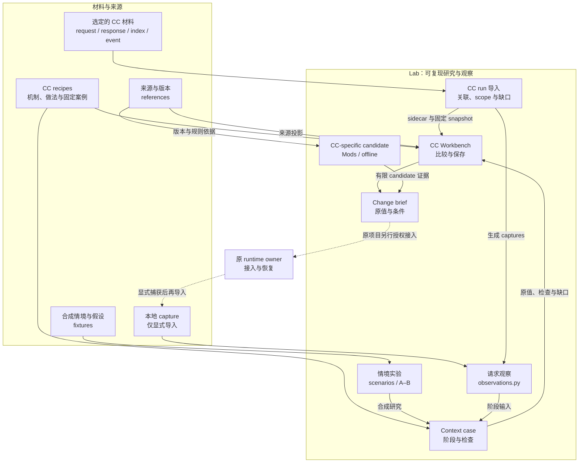

# Claude Code Context Lab

[中文（主文档）](README.md) · [English](README.en.md)

看清 Claude Code 的 context 从哪里来、如何装配、怎样随轮次与续窗变化，再用固定材料检查自己的改动。项目由 **Handbook、Workbench 与 Toolkit** 组成；仓库 slug 保持 `cc-context-lab`。其他 harness 仅作比较参考，通用 wire reader 是实现复用，不是非 CC 产品支持。

完整的 owned core、ambient/present state、自动记忆召回、自主轮次、channel 输入与 compact/resume 承接都在 CC 研究范围内。目标是掌握来源、冲突与生命周期；token 更少并不自动意味着体验更好。

## 三个开始方式

| 你现在要做什么 | 从哪里开始 |
| --- | --- |
| 学习机制与变更方法 | [Handbook](docs/handbook/index.md)：owned core、动态 state、compact/resume 三条路径 |
| 重跑一个固定的合成例子 | 运行下方命令，在本地 Workbench 查看要求、原值、失败与证据缺口 |
| 检查明确选定的 CC run | [CC runs](docs/cc-runs.md)：selection → captures/sidecar → 单份或指定 pair → 固定 snapshot |

需要 Python 3.10+ 与 Node.js；纯阅读无需安装依赖。合成例子的入口：

```sh
python3 scripts/build_context_atlas.py --recipe owned-core --out .cache/cc-context-workbench
```

打开输出目录中的 `index.html`。三条 recipe 使用固定合成材料，既展示结构满足，也展示有意的 FAIL 和未评估项；它们不是已安装配置。Toolkit 的现有脚本负责可重跑的 case、study、请求观察与显式 CC run 导入，Workbench 展示同一 canonical 结果。详细操作见 [Workbench](workbench/README.md)。

## 证据与边界

合成结构检查、公开 source inspection、指定 native build 的离线检查、真实 request 与模型行为是不同证据层。三条 recipe 的 native protocols 尚未执行（`NOT_EXECUTED`），真实生命周期与行为仍是 `NOT_ASSESSED`。已有历史 native 结果保留其原日期、版本和覆盖范围；[current state](docs/current-state.md) 记录当前状态，[research evidence](docs/research-evidence.md) 保留历史。

Lab 不扫描私人 logs、不跟随 capture 中的路径或 URL，不安装 candidate、不启动 scheduler、不调用模型或发送消息。私人 capture 仅由显式输入进入本地页面；输出须在 Git 外或仓库 ignored 且 untracked 的路径。真实请求、身份、配置、transcripts 与私人 continuity 不提交，即使 remote 是 private。外部 Memory/state、生产接入与恢复继续由原 runtime owner 管理。

## 架构与边界



实线表示本地材料与证据路径；虚线表示原 owner 另行授权的接入。单份 request 不足以证明 origin 或生命周期，未知保持 unknown；partial capture 未观察字段不能当作空值或已删除。跨 wire 格式不自动配对。

## 文档地图

| 内容 | 入口 |
| --- | --- |
| 三条完整离线学习路径 | [Handbook](docs/handbook/index.md) |
| 本地交互、固定输入、比较与导出 | [Workbench](workbench/README.md)、[Context cases](docs/context-cases.md)、[CC runs](docs/cc-runs.md) |
| 来源、开关与版本依据 | [Context map](docs/context-map.md)、[Official controls](docs/official-controls.md)、[Upstreams](docs/upstreams.md) |
| 完整个人化与自主轮次 | [Companion context](docs/companion-context.md)、[Continuity and Memory](docs/continuity-and-memory.md) |
| 实验、接入与升级 | [Experiments](experiments/README.md)、[Runtime integration](docs/runtime-integration.md)、[Maintenance](docs/maintenance.md) |
| 当前状态与后续门槛 | [Current state](docs/current-state.md)、[Programme](docs/development-programme.md) |

修改 authored source 后运行 `python3 scripts/check_offline.py`。该统一 gate 不执行官方 binary、网络、runtime probe 或模型；native 检查与真实观察按各自前提另行进行。通过离线 gate 不等于安装、部署或体验验收。

原创功能材料采用 [SUL-1.0](LICENSE)，原创文档、图示与研究编排采用 [CC BY-NC-SA 4.0](LICENSE-DOCUMENTATION.md)。第三方材料保留原权利；这是分层的 source-available 授权，不是整仓统一的 OSI open-source license。复制插件子目录须携带相应授权文件；完整范围见 [LICENSING](LICENSING.md)。维护合同见 [AGENTS](AGENTS.md)。
