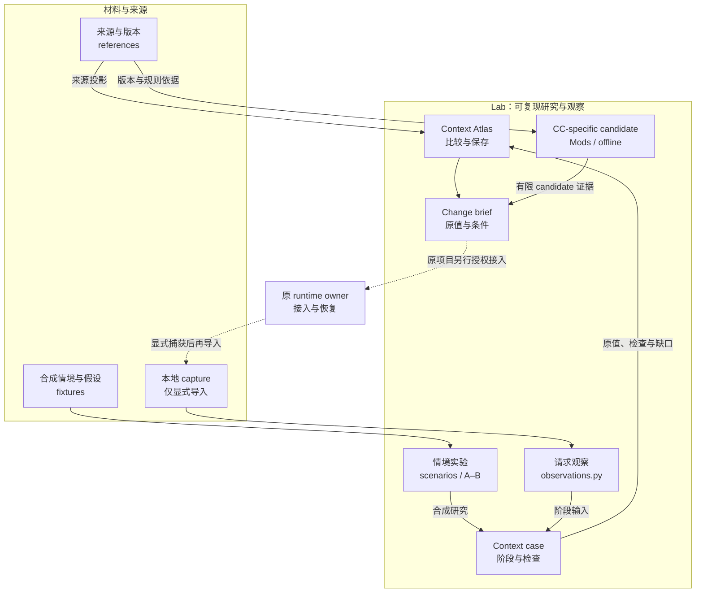

# Harness Context Engineering Lab

[中文（主文档）](README.md) · [English](README.en.md)

研究、比较和维护 agent harness 的 context 来源、装配与生命周期。长期伴侣交互是主要使用语境之一：完整的自有 core、当下感知、自动记忆召回、自主轮次、跨 channel 相处与经历承接都在其中。Claude Code 是目前研究最深入的 harness，项目范围已扩展到跨 harness 的 context engineering；现有 repo / 路径仍使用 `cc-context-lab`，正式名称与 slug 迁移另定。

项目仓库：[GitHub](https://github.com/IndelibleVivi/cc-context-lab)。原创功能材料采用 SUL-1.0，原创研究文图采用 CC BY-NC-SA 4.0；[完整授权范围](LICENSING.md)。

目标是保留 harness 的工具执行、会话和 MCP 能力，同时掌握送给模型的主提示、工具说明、动态 reminders、文件与记忆来源，以及 compact / resume / subagent、Forge / carryover 的继承和重建方式。线程状态、心跳/定时唤醒、context 保留与“阅后即焚”、外部 channel 的输入和交付也在研究范围内。自己的 core 可以充分而完整；研究重点是控制来源、冲突与生命周期，不能把 token 更少直接当成体验更好。

长期用途是为受管 runtime 的 DevOps 提供连续研究依据：看清版本与输入、比较机制、定位升级影响，并把具体配置变更交回原项目验证和接入。完整用途见 [Context DevOps](docs/context-devops.md)。

整体方向与连续建设阶段见 [development programme](docs/development-programme.md)：以具体 context 变更为单位，把研究、可复现对照、目标入口观察、原 runtime 接入与自然使用回填连起来。当前先贯通离线对照，不用合成结果替代实际请求或相处体验。

目前交付是**有出处的研究库、Context Atlas、可复现 A/B 实验、本地请求观察与比较、贯通多阶段输入的 context case，以及 CC-specific source candidate**。观察器能保真读取 Anthropic Messages / OpenAI Responses body；这不是对使用这些格式的所有 harness 提供适配或兼容承诺。尚未提供可直接部署的 context manager/persona/profile 或经真实请求验证的完整剥离方案。当前证据见 [current state](docs/current-state.md)。

## 架构与边界



图示为贯穿案例的主路径，独立 study / request comparison 也可直接进入 Atlas。实线是当前源码的数据/证据路径；虚线是需要原 owner 与对应执行权限的接续操作。Lab 不自动安装 candidate、启用 scheduler、调用模型或发送消息。外部 Memory/state 的内部 authority 继续归原项目。

两种观察必须分开读：合成引擎知道自己如何选择 current/history；单份 request body 不足以确定一个 block 的真正 origin 或生命周期，因此观察器保留 `unknown`。同格式按 JSON pointer 比较位置；跨格式明确不自动配对。部分 capture 可显式声明已观察的顶层字段：未观察字段保持未知，不能补成空历史或判为删除。Responses 中未展开的服务端历史和 prompt 引用会保留为缺口。

## 从这里读

| 你要做什么 | 入口 |
| --- | --- |
| 比较日常提醒和工具话术的保守剥离，并检查原厂更新后的事实保留 | [Daily quiet](experiments/daily-quiet/README.md) |
| 围绕同一问题重跑多阶段输入、检查保留条件与缺口 | [Context case](docs/context-cases.md) |
| 交互查看全景、合成回放、来源与配置变更准备 | [Context Atlas](workbench/README.md) |
| 固定同一材料，比较 A/B 的当下、历史与来源轨迹并重跑 | [Context study](experiments/companion-input/STUDIES.md)、[Atlas 对照研究](workbench/README.md#对照研究与重跑) |
| 检查本地 request 的 instructions/messages/tools、格式与条件差异 | [Request observation](docs/request-observation.md)、[通用观察模块](context_lab/observations.py) |
| 理解伴侣语境中的心跳、ambient、环境 hooks、自动召回与输入头尾 | [Companion context](docs/companion-context.md) |
| 比较心跳节律、事件、自配速与醒来时的输入包 | [心跳的不同跳法](docs/heartbeat-patterns.md)、[离线实验](experiments/companion-input/README.md) |
| 研究 Clef / Decisions API 怎样参与自主轮次判断 | [Heartbeat decisions](docs/heartbeat-decisions.md)、[任务准备与 replay](experiments/companion-input/DECISIONS.md) |
| 对照社区公开实现与版本条件 | [Companion source dossiers](docs/companion-source-dossiers.md) |
| 理解默认指导究竟从哪里进入 | [Context map](docs/context-map.md) |
| 把 Forge / Swap、压缩、Memory 放在一起研究 | [Continuity and Memory](docs/continuity-and-memory.md) |
| 核对 `/compact` 自定义能力与换窗后重载 | [Compact control](docs/compact-control.md) |
| 比较 handoff 与长期 curation 应写什么 | [候选写作合同](experiments/handoff-policy.md) |
| 核对公开续窗脚本的选择规则与信息损失 | [Forge upstreams](docs/forge-upstreams.md) |
| 查官方 CLI、开关与 Mods 的实际边界 | [Official controls](docs/official-controls.md) |
| 对照已有仓库，决定复用什么 | [Upstream dossiers](docs/upstreams.md) |
| 辨认 named prompt 目录里哪些是副本、哪些是改写 | [Prompt differences](docs/prompt-differences.md) |
| 逐项查 reminder 保留/删除什么、patch 如何应用 | [Reminder overrides](docs/reminder-overrides.md) |
| 判断哪些入口可迁到 Mods、哪些仍有缺口 | [Mods migration](docs/mods-migration.md) |
| 设计自己的完整 context profile 与第一份候选 | [Profile design](docs/profile-design.md)、[candidate](experiments/context-profile/README.md) |
| 设计能反驳假设的对照实验 | [Experiments](experiments/README.md) |
| 为已有受管 runtime 准备配置改动 | [Runtime integration](docs/runtime-integration.md) |
| 持续更新来源、版本与结论 | [Maintenance](docs/maintenance.md) |
| 用指定 CC 版本复跑官方离线验证 | [升级检查流程](docs/maintenance.md#检查指定-cc-版本的-candidate)、[检查脚本](scripts/check_context_profile.py) |
| 获取目标 types，观察真实 engine 的 section 组合 | [Target runtime](docs/target-runtime.md) |
| 比较 context 保留、“阅后即焚”与 transcript pruning | [Context retention](docs/context-retention.md) |
| 比较心跳、定时任务、入站消息和外部交付 | [Heartbeat / channels](docs/heartbeat-and-channels.md) |

从伴侣交互出发先读 companion context；定位 CC 输入面再读 context map，把 official controls 与对应 source dossier 并排看。官方合同、社区实际实现和目标版本实测分别提供证据。

## 日常安静的可迁移对照

[Daily quiet](experiments/daily-quiet/README.md) 提供来源有界的纯规则、薄 Mods 接线、native test-kit fixture 和合成 case。它按 engine 类型及已审工具说明片段工作，不锁 CC 版本；新事实与未知文本保留，主身份、工具 schema、权限与 recovery 由各 owner 继续管理。Node 与 Linux CC 2.1.314/2.1.316 的合成事件检查分别记录在 [evidence](references/daily-quiet.json)。这不构成真实 resume、完整请求、模型体验或部署声明。

## 使用方式与边界

修改本仓库的 authored source 后，可运行 `python3 scripts/check_offline.py` 统一检查离线引擎、对照研究、Atlas、candidate 和请求准备器。需要 Python 3.10+ 与 Node.js；不下载依赖、不调用 CC binary、上游网络或模型。第三方原函数复现、实际 runtime 探针与模型实验仍按各自前提单独执行。

用合成的多阶段案例体验完整路径（示例有意保留结构失败，runner 返回 1 并生成报告）：

```sh
python3 scripts/run_context_case.py --demo --out .cache/context-case
python3 scripts/build_context_atlas.py --case .cache/context-case/case.json
```

案例可保存、CLI 重跑、查看逐项期望/原值、跳到关联 study 或显式请求比较，并固定带入 brief。阶段关联由研究者声明，结构 PASS 不等于模型理解；[完整用法与 0/1/2 退出码](docs/context-cases.md)。

也可用纯合成 request 体验独立观察和比较：

```sh
python3 scripts/inspect_context.py experiments/request-observation/fixtures/anthropic-a.json \
  --compare experiments/request-observation/fixtures/anthropic-b.json \
  --out .cache/request-observation
python3 scripts/build_context_atlas.py
```

Atlas 默认展示合成 context case 及其阶段 captures，不扫描真实会话或 logs。如需查看自己明确提供的本地 capture，用 `--capture capture.json`（可重复）生成页面；输出须在 Git 外或 worktree 的 ignored 路径。导入证据是调用者声明，工具不会将它升级为独立验证的 runtime 事实。实际请求正文、身份和私人上下文即使在 private remote 也不提交；[完整用法](docs/request-observation.md)。

纯阅读无需安装依赖。用 `python3 scripts/build_context_atlas.py` 可生成无网络依赖的本地交互页面，见 [Atlas 用法](workbench/README.md)。用 `python3 scripts/check_upstreams.py` 可只读检查十六个公开上游是否更新，需要 Python 3.10+ 和 Git；详细退出码见 [maintenance](docs/maintenance.md)。版本与覆盖声明都带观察日期；上游 source inspection、离线测试、真实 request 和行为结果分别记录。研究里出现的配置命令是实验候选，不会由本仓库自动执行。

可重跑的离线实验和待执行的续窗语义判据统一放在 [experiments](experiments/README.md)。原函数 fixtures 使用 Node.js 或 Python 与已阅读的 exact upstream source，不启动 Claude Code；语料设计不能当成模型实测结果。

对已审阅的自有 candidate，可用 `python3 scripts/check_context_profile.py --claude <可信可执行文件>` 在独立 config 与干净副本上运行官方 `plugin validate` / `plugin test`。它不下载或安装 CC，不开启会话或调用模型；每次保留版本与分层结果，不支持的命令和未知输出不会记为通过。已验证版本及缺口见 [兼容性记录](references/context-profile-compatibility.json)，具体用法见 [maintenance](docs/maintenance.md)。

另有 `python3 scripts/probe_context_runtime.py --claude <可信可执行文件>`：显式启动隔离的本地 slash-command 会话，生成 types、观察真实 engine composition；模型端点指向本机拒绝服务，不使用真实 provider。它与 offline tests 分开，条件和已证范围见 [target runtime](docs/target-runtime.md)。心跳/channel 已有可运行的合成输入包比较与真实机制的待验判据；用 `python3 experiments/companion-input/run_lab.py --check` 生成离线报告，没有创建 scheduler 或接通外部消息服务。

对已有 runtime 的修改继续由其 source repo、candidate renderer 和 operator runbook 管理。本仓库准备可审核的规则、证据和接入说明，不持有生产配置 authority，也不会自动连接或修改部署。受管消费者的安装与运行状态独立记录，不由 Lab 的合成 PASS 推导。

仓库内容面向后续维护者，保留原创技术归纳和公开 source links。私人讨论原文、身份正文、账号配置、真实请求、transcripts 和机器映射放在 Git 外；`.cache/`、`.local/`、`artifacts/` 等仅作本机缓存。第三方代码与原厂提示全文不 vendoring。

原创代码、脚本、测试与可执行实验材料使用 [SUL-1.0](LICENSE)，属于 source-available；原创文档、图示与研究编排使用 [CC BY-NC-SA 4.0](LICENSE-DOCUMENTATION.md)。第三方引用和外部 checkout 保留原有权利；不是整仓统一授予任意商用的 OSI open-source license。复制插件子目录时也需携带相应许可和 [path map](LICENSING.md)。

维护约定见 [AGENTS.md](AGENTS.md)。
