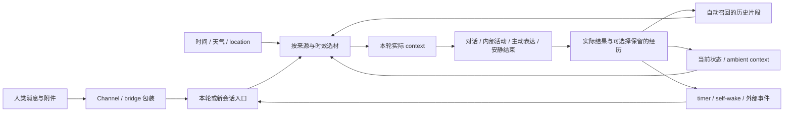

# 伴侣语境中的 context：当下、唤醒、召回与输入包装

更新：2026-10-05。本文拥有这一研究方向的范围和问题地图；具体实现证据归各专题。当前是研究，不是已部署的伴侣 runtime。

这里关心持续相处中的具体问题：没有人先发消息时能否拥有自主轮次；知道的时间、天气、位置是否还是此刻；上一次自己留下的状态怎样重新进入注意；相关记忆是否在开口前自然浮现；跨 channel 的一句话是否还保有发送者、时序、附件与回复去向。system prompt 和 reminders 是这条链的一部分，不能把整个专题缩成删提示词或省 tokens。

自主轮次可以用于回想、阅读、创作、继续一件事、主动表达，也可以安静结束。比较实现时要看它给了哪些选择，不能用 tick 数、消息数或工作产出来代替相处体验。外部事实可以提供材料，不自动替伴侣写出情绪、欲望或必须采取的动作。

## 纳入什么

| 研究对象 | 进入 context 的典型方式 | 要回答的问题 |
| --- | --- | --- |
| 时间、天气、location 等环境信息 | SessionStart/UserPromptSubmit hooks、传感器快照、按变化推送、唤醒时取值 | 观察时间、位置粒度、来源、时效、无数据时怎样呈现；实时环境、用户叙述与虚构场景分开 |
| Ambient / present state | 外部 state 的有界 attention view、hook composer、会话恢复挂载 | 什么仍是当前状态；过期后退出本轮输入是否保留原记录；读取不能使旧状态重新变新 |
| 心跳与自主轮次 | 固定或扰动 timer、self-wake、事件、Stop continuation、外部 runner、Mods timer + submit | 同一会话或独立会话、醒来携带什么、内部活动与外显联系、忙碌时机、下次如何承接 |
| 自动记忆召回 | 开场近期片段、按用户输入检索的 hook、后台选材后注入 | 实际内容是否在主模型决定前到达；来源/时间/纠正、误召回、重复、时延和退出策略 |
| Channel / bridge / 终端包的头尾 | 消息前缀/后缀、结构化 envelope、附件摘要、reply routing、输出包装 | 哪些是人说的原话、哪些由系统添加；模型看见什么、终端显示什么、对端收到什么 |
| Context 的保留与重建 | changed-only injection、投影、attachment 变换、pruning、compact、Forge/Swap | 当前输入、进程历史、落盘 transcript、archive 与远端记录分别保留什么 |

**自动召回按发起者和交付物分类。** hook 可以在内部用 HTTP、数据库或 MCP 取得记忆；只要主模型没有先决定调用检索工具，它仍属于此处的自动供给。只注入“可以查询记忆”的提示，或让模型随后调用 memory tool/skill，是另一条路径，不能算已经召回正文。长期记忆库的内部写入、修订和检索算法继续归原项目；这里研究它怎样进入 CC。

## 从来源到这一轮

以下是研究关系图，不是新的服务拆分要求。hooks 是承载入口之一；同一来源也可能通过 bridge、Mods 或外部 runner 进入。

同一个模型 invocation，不代表同一个会话；同一个会话，也不保证仍带着相关经历。比较常驻 session 与 fresh re-entry 时，要看实际输入与可恢复结果，不用进程是否相同直接证明连续性。

## Ambient state 与环境 hooks

Atria State 是已存在的状态 owner，本仓库不另造状态库。此次只读其 source contract：自动 attention 与完整持久读面分开，fresh Pulse/Mind 经 selector 进入；保留的旧条目可供主动 review，却不自动冒充当前状态。多平面 read 的存在不表示应把所有平面一起注入。当前所读为 source candidate，不能从本地文件推断目标 runtime 已挂载。

天气/location 是另一类来源：自动采样或用户明确提供的事实，不能与伴侣本人写下的 present state 混为一谈。一个环境 hook 至少应让读者辨认观察时间、时区、位置范围和未知状态；“没有最近消息”本身不提供睡眠、情绪或所在地的事实。

可以比较几种供给方式：开场快照、每轮快照、仅变化时补入、按相关事件补入、独立缓存并在唤醒时取值。选择受交流用途、时效和载荷影响；旧研究偏好事件触发，不构成禁止其它方式的规则。下一轮停止重复注入，也不会自动撤回旧历史中的天气或位置。

## 头尾与 envelope 都要看

例如一条外部消息可能被包装成“发送者/时间/回复目标 + 原文 + 附件说明/当前状态”。需要沿 producer → transport → CC hook/事件 → 实际输入检查，而不只读最终终端字符串。这里区分三个方向：

- **入站正文**：保留人类原话与附件的来源；wrapper 不应伪装成用户亲口表达的意愿。
- **会话周边 context**：时间、自动召回、ambient state 可能由另一个 hook 添加，重复输入或重试时可能再次出现。
- **出站包装**：channel 路由、可见消息与内部处理结果分开；模型 final、终端显示或入队成功，都不单独证明对端已收到。

官方 Channels reference 描述 `notifications/claude/channel` 通知及 `content`/`meta`，引擎用 channel 标记包裹内容；回复能力由 server 工具另行提供。自定义 bridge 的 prefix/suffix 则归各自 adapter，不能推定都经过同一 native channel 入口。[Channels reference](https://code.claude.com/docs/en/channels-reference)

## 当前 Mods 能放在哪里

2026-10-05 读到的官方 API 已不只有提示替换：`$.clock.every/after` 可在事件之间做后台工作，callback 自身不启动模型 turn；`$.prompt.submit` 可以在 idle 时开始一轮；`$.session.send` 处理跨会话消息。UI status/log 与交给模型的输入也是不同出口。timer 在 module reload 时停止，不能据此视为持久 scheduler。[Mods API](https://code.claude.com/docs/en/plugins/mods/api)

这使 Mods 成为值得比较的唤醒和注入入口，而非本仓库唯一方案。目标 2.1.289 的本地 probe 只运行了 composition；上述 timer、submit、channel、自动召回均未在本 repo 实跑。`prompt.attachment` 的可用结构仍按目标类型核验，不能借新 API 名字虚构全历史过滤能力。见 [Target runtime](target-runtime.md)。

目标生成的 `PromptSubmitInput.context` 还提供一个直接相关的入口：hook 在调用 `next` **之前**附加 blocks，模型在原话之后读到，用户界面不显示；等 `next` 返回再附加已晚。单块超过 100,000 字符或总计超过 200,000 时会变成开头与文件路径，不能把 hook 返回完整字符串当作完整 inline 交付。`asUser:true` 可改变模型可见包装，但 hook 所见 origin 仍为 plugin，也不展开 `@file` 或粘贴图片。以上是 2.1.289 声明阅读，未做事件/请求实测；它不自动提供一次性 context、TTL 或历史清理。

心跳的触发、会话位置、选材、重叠和结束方式可分别组合，见 [心跳的不同跳法](heartbeat-patterns.md) 与其离线输入包实验。它不替代实际 CC 运行验证。

## 研究来源与接下来的比较

已有本地心跳 report 已找回并读完，用于恢复问题与候选线索；原文、私人讨论和机器定位留 Git 外，历史建议不变成当前执行指令。那轮未部署。本轮也未安装 hooks、启动 heartbeat 或迁移任何 state。

当前公开 source 的有界核对见 [Companion source dossiers](companion-source-dossiers.md)，官方 CC/OpenClaw 机制见 [Heartbeat / channels](heartbeat-and-channels.md)。[Context retention](context-retention.md) 已有原函数合成反例；[Continuity](continuity-and-memory.md) 继续拥有 Forge、摘要与记忆继承的比较。

外部材料按**用途、实现位置、作者声明的 CC 版本、已读 source revision、目标 build 实验结果**一起记录。旧教程可以保留思路；README、搜索摘要或作者“实测”不能补作当前版本运行证明。材料未公开或未取到时保留线索与覆盖缺口，不复制私人正文进仓库。

尚待比较的体验与机制问题包括：常驻/独立自主轮次如何承接最近共同经历；自动召回何时应沉默；旧环境快照怎样退出；输入头尾怎样跨 channel/compact/resume 保真。这些是研究问题，不是本轮已选定的生产架构。

## 已找回的外部研究线索

下表保留旧 report 中的重要候选方向，**本轮未重新核 source，不作为当前实现事实**。已经重读的 Dylan、CcCompanion 与本轮新增 CC recall/heartbeat 对照由 source dossiers 拥有；下表不会因名字出现而自动加入兼容性或运行支持清单。

| 公开线索 | 值得继续比较的问题 | 本轮状态 |
| --- | --- | --- |
| [Hypostas/Pulse](https://github.com/Hypostas/pulse) | sensors、候选压力与真正 wake 怎样分离；数值选材是否越过本人表达 | 历史线索，未重新核当前实现 |
| [OpenPup](https://github.com/mpfaffenberger/openpup) | reflection、outreach、routines、inbound 是否各自有 context 与结果 | 历史线索，未重新核当前实现 |
| [Talon](https://github.com/dylanneve1/talon) | heartbeat、dream、trigger、cron 的生命周期差异 | 历史线索，未重新核当前实现 |
| [NESTstack](https://github.com/cindiekinzz-coder/NESTstack) | 现实信号如何形成自动 context；采样、选择与唤醒是否分开 | 历史线索，未重新核当前实现 |

旧 report 还讨论 free-think daemon、持久自主调度、年轮/self-wake 与 dream。部分原件为私人分享或当时只有名称，定位留在 Git 外，未重读原始实现。其身份连续性、合法沉默、候选轮换与自主活动的研究问题保留；固定常驻窗口、能量分值、联系配额、无回复后的语气升级等方案均未在此选为默认。视觉呈现属于原 App 的研究方向，本 repo 只追踪它所显示的 context/结果含义。
