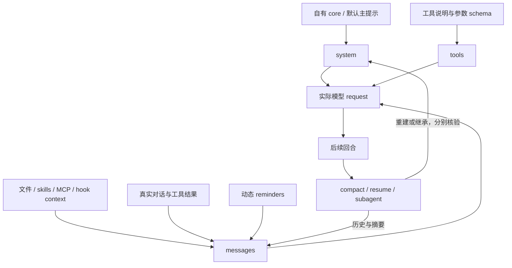

# Context map

问题：当主提示已经替换，CC 还可能从哪里把指导和事实送给模型？

以下是基于官方 request 结构和接口的研究模型，不表示已经部署了图中的自有 profile。节点表示输入位置，箭头表示正文或状态流动；Mods 的具体覆盖受 build 类型声明和运行开关限制。

system / tools / messages 的依据：[官方 prompt guide](https://code.claude.com/docs/en/agent-sdk/modifying-system-prompts)、[request logging](https://code.claude.com/docs/en/monitoring-usage#api-request-body-event)。生命周期行为见 [CLI reference](https://code.claude.com/docs/en/cli-reference#system-prompt-flags-in-resumed-conversations)。图的生命周期节点合并了不同机制，不暗示它们调用同一个 hook。

## 按层研究

| 层 / 输入 | 可评估的控制入口 | 必须单独验证的事实 |
| --- | --- | --- |
| 默认主 system prompt | CLI replacement；Mods section / compose | 真正替换了哪些 section，何时重建 |
| 输出风格与 persona | 已选 output style、自己的 core | 是否还叠加其他指导；不以称呼替换代替整体目标 |
| 工具说明 | `tool.describe`；Git guidance 原生开关；版本绑定 patch | 描述改变与工具 schema / 执行权限是不同变化 |
| 动态 engine reminders | 来源开关、`prompt.attachment`、结构化 detail | 类型、来源、scope、动态事实和内嵌原文边界 |
| 初始 CLAUDE.md / instruction files | 原生加载开关、`prompt.context` | 初始来源与后续 Read 触发的嵌套加载是否都覆盖 |
| skills / bundled workflows | 原生开关、`skill.prompt` | 发现清单、实际加载、用户和插件 skills 分开 |
| MCP server instructions | 选中 MCP 配置；上游 patch 候选 | 工具仍可用时，哪些额外指导仍进入请求 |
| hook additionalContext | 自有 hook composer、注入时机 | 应用事实与用户发言区分，避免重复记忆或状态 |
| 历史 hook context | 合成 transcript pruning / replay 对照 | 改了磁盘不等于改了进程内历史；UUID 链条与非目标行 |
| compact / utility prompts | 观察 compact request；版本绑定模板研究 | 跳过 compact 与改写摘要模板不同；summary 保留什么 |
| resume / continue | system snapshot 策略、历史重放 | 新设置、保存的旧 system、历史提醒三者不同步 |
| 普通 / fork subagent | 子代理定义、追加入口、继承策略 | 主线程生效不能推导子线程生效；CLI mode 限制 |

各入口的具体已知能力和未知覆盖见 [official controls](official-controls.md)；表中“候选”不等于接口已足够或可部署。

## 改写时保留什么

原厂措辞没有必须保留的特殊地位；其承载的事实仍需有明确出口：实际 cwd / 时间、可用工具、参数与错误、来源身份、未完成任务、结果是否对用户可见、恢复所需承诺。

模板可以换，文档引用不能因字串恰好相同而被改。优先在“模板 + 原始材料”尚有结构边界的位置处理。没有结构信息时，把整段 `engine` 文本视为可自由改写并不成立。

减少任务催促、改变称呼、减少 token、保留非空可见交付、探索质量和长期一致性是不同评估维度。某一项改善不能代替其他项的证据。
