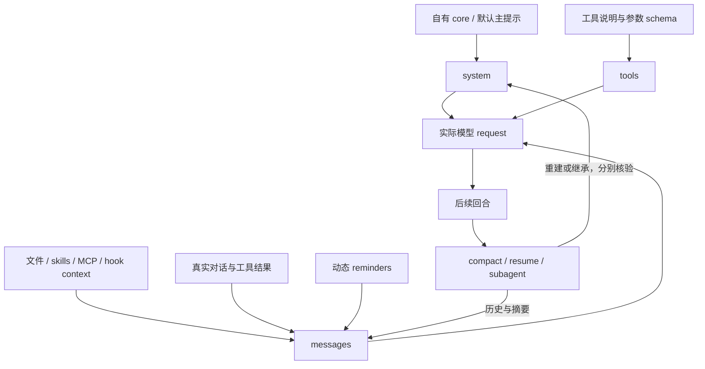
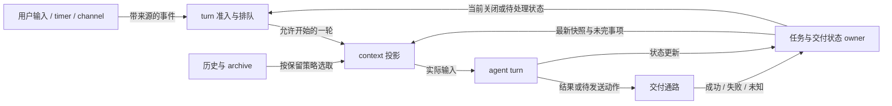

# Context map

问题：这一轮 CC 从哪里得到指导、当下信息、历史经历与消息来源，它们怎样随时间和会话变化？伴侣交互中的问题地图见 [Companion context](companion-context.md)；主提示替换只覆盖其中一部分。

以下是基于官方 request 结构和接口的研究模型，不表示已经部署了图中的自有 profile。节点表示输入位置，箭头表示正文或状态流动；Mods 的具体覆盖受 build 类型声明和运行开关限制。

system / tools / messages 的依据：[官方 prompt guide](https://code.claude.com/docs/en/agent-sdk/modifying-system-prompts)、[request logging](https://code.claude.com/docs/en/monitoring-usage#api-request-body-event)。生命周期行为见 [CLI reference](https://code.claude.com/docs/en/cli-reference#system-prompt-flags-in-resumed-conversations)。图的生命周期节点合并了不同机制，不暗示它们调用同一个 hook。

## 按层研究

| 层 / 输入 | 可评估的控制入口 | 必须单独验证的事实 |
| --- | --- | --- |
| 默认主 system prompt | CLI replacement；Mods section / compose | 真正替换了哪些 section，何时重建 |
| 输出风格与 persona | 已选 output style、自己的 core | 是否还叠加其他指导；不以称呼替换代替整体目标 |
| 工具说明 | `tool.describe`；Git guidance 原生开关；版本绑定 patch | 描述改变与工具 schema / 执行权限是不同变化 |
| 动态 engine reminders | 来源开关、`prompt.attachment`；detail 以目标 types 为准 | 类型、来源、scope、动态事实和内嵌原文边界；目标 2.1.289 仅声明三类 plan-mode detail |
| 初始 CLAUDE.md / instruction files | 原生加载开关、`prompt.context` | 初始来源与后续 Read 触发的嵌套加载是否都覆盖 |
| skills / bundled workflows | 原生开关、`skill.prompt` | 发现清单、实际加载、用户和插件 skills 分开 |
| MCP server instructions | 选中 MCP 配置；上游 patch 候选 | 工具仍可用时，哪些额外指导仍进入请求 |
| hook additionalContext | 自有 hook composer、注入时机 | 应用事实与用户发言区分，避免重复记忆或状态 |
| ambient / present state | state attention selector、SessionStart / 按轮 composer | 当前视图与保留记录分开；读取不续期，空状态有效 |
| 时间 / 天气 / location | 环境 hooks、传感器快照、按变化或事件注入 | 观察时间、来源、位置粒度和过期；事实不替模型写情绪 |
| 自动 memory recall | 开场片段、UserPromptSubmit 检索与注入 | 记忆正文、检索提示和模型主动调用分别标注；来源、重复、较新纠正与时延 |
| Channel / bridge 输入头尾 | producer prefix/suffix、消息 envelope、附件与路由 metadata | 终端显示、用户原话、本轮模型输入与外部回复分别追踪 |
| 历史 hook context | 合成 transcript pruning / replay 对照 | 改了磁盘不等于改了进程内历史；UUID 链条与非目标行 |
| compact / utility prompts | `session.compact` 的 instructions/messages；观察 request；版本绑定模板研究 | 事件改写与每个内部模板的覆盖不同；summary 保留什么 |
| resume / continue | system snapshot 策略、历史重放 | 新设置、保存的旧 system、历史提醒三者不同步 |
| 普通 / fork subagent | 子代理定义、追加入口、继承策略 | 主线程生效不能推导子线程生效；CLI mode 限制 |
| Forge / carryover / self-handoff | 会话适配、原生 context 投影、controller 换代 | 原事件覆盖、较新纠正、旧窗停止、新输入交付与语义连续性分别验收 |
| Durable Memory / cold archive | curate、revision、按需检索 | 存在 / 可找到 / 已加载 / 正确理解不同；继承摘要不能算新确认 |
| heartbeat / scheduled wake | session timer、外部 scheduler、runtime controller | tick、turn 准入、busy/idle、关闭任务、重启持久化分别确认 |
| external channel / mailbox | 入站来源验证、排队、回复工具、交付状态 | 收到消息不等于已处理；工具输出不等于已送达；重试不应重复外部动作 |
| 动态 context 有效期 | producer 快照、request 投影、标记式 pruning | 本轮省略、进程内状态、磁盘历史和远端消息是不同修改面 |

各入口的具体已知能力和未知覆盖见 [official controls](official-controls.md)；表中“候选”不等于接口已足够或可部署。

跨窗口的存储、投影与职责图见 [continuity and memory](continuity-and-memory.md)。界面 conversation、provider session 和本轮 request 不必一一对应；新建 session 不自动保证内容更合适。

## 线程什么时候醒来，资料什么时候退出

下图是研究职责图，表示待比较的控制关系，不是本 repo 已部署的服务。图中 context 投影负责本轮取舍，状态 owner 保留任务与交付事实；外部交付反馈须有可观察结果，不能从 tick 直接推出。

清理策略和原函数反例见 [Context retention](context-retention.md)，心跳/调度/channel 的具体实现对照见 [Heartbeat / channels](heartbeat-and-channels.md)。图只表达这些机制共同需要回答的问题，不要求为研究新建 controller 或 Memory backend。

## 改写时保留什么

原厂措辞没有必须保留的特殊地位；其承载的事实仍需有明确出口：实际 cwd / 时间、可用工具、参数与错误、来源身份、未完成任务、结果是否对用户可见、恢复所需承诺。

模板可以换，文档引用不能因字串恰好相同而被改。优先在“模板 + 原始材料”尚有结构边界的位置处理。没有结构信息时，把整段 `engine` 文本视为可自由改写并不成立。

自己的 SessionStart handoff 也可能经 `additionalContext` 包成 system reminder。清理默认指导必须保留这条有意选择的输入通路，并检查长字段是否被文件化；具体官方边界见 [continuity and memory](continuity-and-memory.md)。

减少任务催促、改变称呼、减少 token、保留非空可见交付、探索质量和长期一致性是不同评估维度。某一项改善不能代替其他项的证据。
