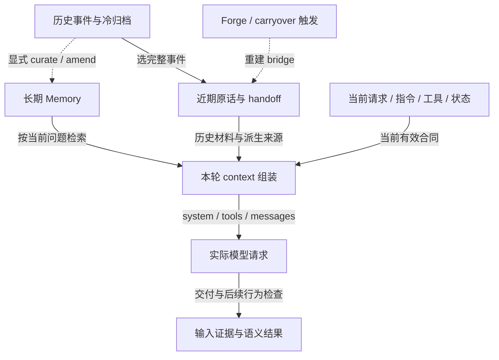

# Continuity、Forge / Swap 与 Memory

观察日期：2026-10-05。本文是可复用研究与候选设计；没有安装 context manager、执行真实换窗或验证模型行为。公开算法证据见 [Forge upstreams](forge-upstreams.md)，按层控制入口见 [context map](context-map.md)。原生 compact 的具体接管合同见 [Compact control](compact-control.md)，候选内容规则见 [Handoff policy](../experiments/handoff-policy.md)。

## 一个研究范围，几个不同的操作

Harness 决定模型这一轮能看见哪些指令、工具、历史和外部材料。主提示、reminders、compact、续窗和 Memory recall 因而属于同一个 context 研究范围；心跳/外部消息决定何时开始一轮，保留策略决定旧 context 何时退出，它们也需要放在同一生命周期里比较。各自的状态和修改权限仍须分清。[Claude Code 架构说明](https://code.claude.com/docs/en/how-claude-code-works) 将 context 管理列为 harness 职责。

具体实现另见 [Context retention](context-retention.md) 与 [Heartbeat / channels](heartbeat-and-channels.md)；伴侣语境中的 ambient context、环境 hooks、channel 输入头尾和自动记忆召回见 [Companion context](companion-context.md)。自动召回由 hook/adapter 在主模型决定前选材并送入，内部即使用了 MCP/HTTP 也与模型主动检索不同。研究交付不把 Relata/Tilia 的 Memory 存储或现有 runtime 的生产 authority 搬到本 repo。

| 操作 | 修改的对象 | 不能从它推出 |
| --- | --- | --- |
| 主提示 / reminder 改写 | 当前或下一次 request 的指导与包装 | 历史提醒已消失；子代理也使用相同输入 |
| 近期原话 carryover | 新输入包含哪些原事件 | 较早依赖、原附件和工具能力也被搬走 |
| Self-handoff / compact | 对旧上下文的派生表达 | 摘要准确，或曾被省略的原文重新可见 |
| Fresh provider session | harness 的 session/binding 与恢复路径 | 用户界面必须换一条 conversation；模型输入自动变干净 |
| Memory curation / revision | 长期可检索内容及其版本 | 某条记忆已在当前 request 中，或已经正确理解 |
| Memory snapshot rollback | durable database 的状态 | 能替代会话 carryover，或属于无副作用的压缩 |

Forge/Swap 不是跨项目统一协议。旧教程的 Swap 曾指近期对话搬运；LMC-5 使用 Swap 指 Memory 快照回滚、另用 Refined Session Carryover 指精炼续窗。自有 runtime 也可能把 Swap 定义为复用既有 handoff。每次比较须先给出输入、输出、authority 和副作用，不凭同名判断兼容。

## 三种存储视角与一次输入投影

完整 archive 留下发生过什么；conversation ledger 拥有应用认可的消息与事件；durable Memory 保存经过选择、可修订的长期材料。某项材料可以存在、可检索、已选入 request、已被正确使用——这四步分别需要证据。

下面是候选职责图，不表示本仓库已经实现组装器。箭头表示数据流，虚线表示显式操作；近期原话和 handoff 共同进入输入，archive 不自动整库装入。

此图依据公开 harness / compaction 机制归纳职责，不把 source map 或跨 harness 接口画成已经存在的服务。持久化、模型可见性与语义使用是三条独立验收边界。

## 与重型系统提示、reminders 的直接接缝

CC 的 `additionalContext` 会以 system reminder 包装进入对话；来源分区不保证内容不会影响语气或被模仿。每个字符串有 10,000 字符上限，超限会变成文件路径与最多 2,000 字符预览，CLI 不要求模型读取该文件。多个 hooks 的字段分别计量；自有 composer 若先合成一个字符串，则应核完整合成结果。[官方 Hooks reference](https://code.claude.com/docs/en/hooks#add-context-for-claude)

因此清理默认 reminders 时需要保留自己仍依赖的 context 通路：

- 分辨默认模板、动态运行事实、外部引用和应用提供的 handoff；相同 XML 标签或 `engine` origin 不足以区分。
- 模板可以改写，近期原话、纠正、来源身份、工具结果和恢复状态不能因为外包装冗长而一并清空。
- 新 session 的初始装配、旧 session 的 snapshot/resume、compact 之后的重装分别观察。删掉下一次注入不会追溯改掉已记录历史。
- 使用自己的主提示或来源开关时，同步检查负责注入 handoff、Memory 与当前状态的 hooks 是否仍执行。默认指导减少与连续性保留是同一实验中的两个结果。

相关候选入口已列在 [Mods migration](mods-migration.md)。研究时分别检查“沿用默认摘要流程并改指示”和“由 handler 直接提供 compact 后的 messages”；这决定自有 writer 的位置。接口与证据见 [Compact control](compact-control.md)。接管某条 compact 路径不代表已经覆盖所有 utility prompts，也不能据此推定任意 provider 都支持同样的续窗。

## Handoff 要保住的内容

候选默认组合是“较远历史的 handoff + 近期完整原话 + 按需长期检索 + 当前运行事实”。这是一项待比较的选择，不否定纯 tail 或原生 compact 在某些任务中的优势。

压缩前先明确允许损失什么。工具噪声可以有短保留期，接受过的纠正、未完成承诺、指代所需前文和授权范围需要更高保真；重要性不能只由字符长度、技术词密度或关系关键词决定。工程事件也可能同时承载个人意义，两个检索入口可以共享同一来源。

| 内容 | 必须能保留或查回的关系 |
| --- | --- |
| 人的近况、稳定偏好 | 当时状态与长期属性分开；不要把一次情绪固化为永久设定 |
| 共同事件、对话氛围 | 发生了什么、为什么有意义、当时注意停在哪里；不只留下主题标签 |
| 任务进展、尚未结束的讨论 | 已决定 / 仅提议 / 被否决 / 待确认，及当前论证停点 |
| 愿望与承诺 | 适用条件、当前有效性、是否后来取消或完成 |
| 错误与修正 | 被纠正的旧理解与采用的新理解，避免下一窗重犯或复活已关闭事项 |
| 未完成外部动作 | 准备 / 已提交 / 已交付 / 结果未知；历史动作不能被当成新命令重放 |

Handoff 是一次可替换的派生快照。更新时吸收仍有效的内容、修订旧判断、移出已关闭事项，不机械堆叠历代摘要。原件保存在冷归档；退出自动装载不等于删除，但若没有检索线索，也可能实际找不回来。

第一人称能帮助承接已有语气，但不能抹掉说话者和来源。只有旧摘要时，不应把其中的转述升级成精确原话；模板要求记录氛围，也不允许补写输入里没有的感受、动作或感官细节。归档可有完整叙事，下一窗的预算则必须按实际 transport 计算。栏目齐全与“字数不限”都不能解决装载上限。

关闭事项通常退出活动清单；若存在重复提交、重复预约一类后果，则保留必要的关闭标记和原因，而不是把“已完成”从下一窗所有证据中抹掉。对自己的失误记录事实与影响，同时保留当场已经接受的纠正；不需要等多窗归纳才承接明确的新要求。

只有消息 JSON 合法或 UUID 链完整仍不够。“沿第二个继续”依赖之前两个选项；保留最后一句却丢掉选项，会造成结构有效、意义断裂。历史 tool call/result 要么作为完整协议单元处理，要么明确投影成历史文字；已有日志不赋予当前 runtime 新工具，也不授权重做动作。

## Memory curation 与来源继承

以下是研究要求，不是本仓库已经部署的 Memory schema 或重新实现数据库的提议。

先想象未来会如何找这件事，再决定标题、正文和召回线索。`topics/entities/triggers/aliases` 可以帮助找到条目；过宽的人名或泛用词可能放大噪声。`anti_triggers` 应有适用范围，不能变成不看上下文的永久禁词。暂时说不清 focus 的材料可留候选证据，不能因还未命名而自动丢弃。

将置信度、时效、重要性和待复核状态分开考虑。一件只发生过一次的事也可能证据明确而且重要；`current/review` 一类单字段无法同时表达这些维度。

来源应区分原事件、摘要继承、新断言、独立确认和撤回。一条原话经过五次 handoff 仍是一条来源，不能积累成五次用户确认。候选 source map 应能追溯派生段落到事件或明确范围；operation/cutoff 能证明边界，不能单独证明每一句解释都有对应原文。

事件时间、记录时间、session 时间和自然语言的“昨天”分别保存或注明解释依据与 timezone；不要把跨午夜换窗变成截止日期变化。引用时间与 IDs 尽量从结构化记录取得。

人的日界与日历日也须分开。“还没睡，所以仍算昨晚”可以作为叙述，但不足以自动算出“后天”的 deadline。保留原说法、事件时区及解释依据；有歧义时明示，不能把睡眠状态当作通用时间换算算法。

Curation skill 负责判断和表达；backend 负责可靠写入、索引、幂等、部分失败与 supersession。没有理由只因研究 Forge 就建立第二份 canonical Memory。修错也应落在正确层：handoff 失真重新写 handoff，Memory 错误修订 Memory，transcript 损坏由 runtime 恢复。

具体 skill 的 JSON 示例与 shell 命令不构成后端协议证据。接入前需要对照真实 writer 接收的字段、默认 dry-run / apply 行为、时间推导以及索引成功回执。摘要的格式检查也不能证明多存储写入具有原子性。当前只形成 [两份候选写作正文与合成例子](../experiments/handoff-policy.md)，未导入任何旧 skill 或执行其命令。

## 实现位置比较

| 位置 | 本轮核对的公开机制 | 对本研究的价值与限制 |
| --- | --- | --- |
| 会话文件适配 | LMC-5 Carryover | 可检查筛选与截断；生成 JSONL 不证明 resume、工具配对或语义保真，见 [源码 dossier](forge-upstreams.md) |
| Runtime 原生 | Pi compaction / extensions | 追加 compaction entry 后按保留边界重建输入；保留历史与当前投影分开。`context` 与含 system 的 `context_with_system` 有不同合同；本轮仅读文档，未装 Pi |
| API proxy | CliffCompaction | README 描述用 hash-chain prefix 替换历史；依赖前缀稳定性、失败透传，需协调原生 compact。本轮未运行 proxy，未审其全部实现 |
| 模型服务 API | Claude context editing / compaction | 服务端清旧结果，或生成摘要并保留近期轮次；API 可用性不能推导现有 CC/第三方 provider 已接入 |

Pi 固定为 [`76dfb88f` compaction reference](https://github.com/earendil-works/pi/blob/76dfb88f63ce51ff2e3fe2ead4fcf1f65f71f121/packages/coding-agent/docs/compaction.md) 与 [extension contracts](https://github.com/earendil-works/pi/blob/76dfb88f63ce51ff2e3fe2ead4fcf1f65f71f121/packages/coding-agent/docs/extensions.md)。已读 relevant compaction/entry/cut-point 与 context event 小节，未审所有实现或示例。

Cliff 的 [`b48d660a` README](https://github.com/nguyenvuthientrang/cliffcompaction/blob/b48d660ae3c1f6037094d6cfc6b5d9f5938a7957/README.md#how-it-works) 与 [论文 v1 §2](https://arxiv.org/html/2609.26779v1#S2) 明确每次丢弃上一压缩块，只压当前活跃区段。这以远期直接 recall 换取新的压缩不再递归改写旧摘要；残余影响不等于可检索证据。本轮只核机制与限制，未复现 benchmarks，不据 coding-task 结果推定关系连续性收益。

[Claude compaction overview](https://platform.claude.com/docs/en/build-with-claude/compaction) 现在区分 on-demand、threshold 和自管摘要：前两者的保留近期轮次流程不同，不能把旧例子里的参数混用。这里只采用“摘要与原话可组合”的机制事实，兼容性以所选 API/model 为准。[Context editing](https://platform.claude.com/docs/en/build-with-claude/context-editing#context-editing-and-prompt-caching) 说明清除工具结果会破坏受影响缓存前缀；更短输入不保证每轮成本更低。

## 多个 manager 的变换合同

候选 context assembler 应留下五项可解释信息：输入来源与 revision；采用/省略理由；派生关系；覆盖与未覆盖区间；本轮实际输出及预算。它可先由现有组件共同提供，无需立刻做一个新服务或通用 compiler。

顺序具有语义：先删 reminders 可能先删掉 handoff；先截近期尾部可能切掉否定旧偏好的纠正；compact 改历史后可能让 proxy 的 prefix 映射失效；检索可能把已撤回的旧结论再次带回来。一个 manager 提供候选材料，另一个拥有最终投影时，必须说明谁会再次改它，以及 trace 观察位于变换前还是后。

保留稳定前缀、近期渐进追加、在明确边界重组是待测策略。模型变化也会改变 reset 的收益；[Anthropic 长任务 harness 实验](https://www.anthropic.com/engineering/harness-design-long-running-apps) 报告其 Sonnet 4.5 与 Opus 4.5 方案采用不同 reset 选择，不能升格为所有模型必须定期重开。

## 验收分层

1. **来源与结构**：完整事件、工具协议、来源引用、cutoff 和已关闭事项是否保存；算法原函数可用合成材料验证。
2. **运行时接管**：旧窗停止、fork 与新窗身份、请求准入、失败恢复和副作用是否正确。成功生成文件或 transcript 增长只覆盖部分证据。
3. **实际交付**：hook receipt、hook stdout、最终 request 是不同层；要检查模型请求中的真实内容以及中间是否文件化/再次截断。
4. **语义行为**：承接指代、提议与决定、较新纠正、氛围与未完注意；跨多次续接，检查来源是否被误计为新确认。
5. **代价**：输入与输出、摘要调用、cache hit/write、延迟、失败恢复、补充检索。总 token 与行为质量一起比较。

待执行的统一合成语料与拒绝条件见 [continuity cases](../experiments/continuity-cases.json)。比较纯近期原话、摘要+尾部、规则筛选、Memory+短桥接，以及现有 self-handoff+完整 tail；固定模型、最终输入和可用预算，报告实际开销。规则测试已经复现某种损失，不代表模型行为已实测；模型准确复述关键词也不代表成功续接。
