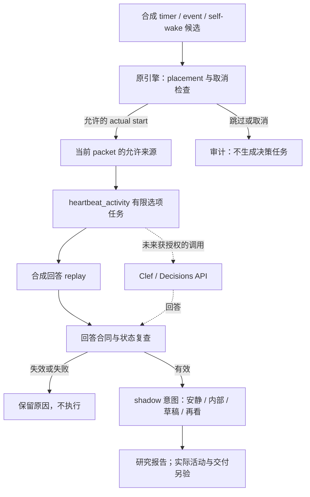

# 心跳中的 typed decisions

观察日期：2026-10-13。研究对象是 Clef、Jev / SystemOne、OpenAI Decisions 一类 typed decision API：给定情境与有限选项，取得结构化判断。本专题不把“决策模型”解释为普通 chat LLM planner。当前交付为离线任务准备与 scripted replay；模型质量、线上延迟与真实 CC 接入均未验证。

## 从已有 Decisions Lab 接回来

Decisions Lab 已有 next-action 合成实验、原生 Jev / OpenAI Decisions profiles、失败分类与评估方法。本次只读其 `docs/integration.md`、`docs/method.md` 与相关 source；读取基线为 `e6e2446c7a04b8984cd21b0d87ab481329f3367d`。可复用的是任务定义、可接受答案集合、baseline、分开记录 unknown/refusal/error，以及不把 confidence 当正确率的方法。

它的现有 profiles 绑定 next-action 选项和结果校验，不能原样当成心跳 adapter。CC Context Lab 因而拥有自己的 `heartbeat_activity` 用途合同、合成情境和线程限制；API 机制、provider 比较和未来 transport 接入仍与 Decisions Lab 协作。这里不复制其实现，不增加生产 router。两边的具体读取范围与公开依据见 [source record](../references/heartbeat-decisions.json)。

## 值得引入的判断

规则适合回答“计划有没有取消”“主聊天是否仍占用”“天气是否过期”。决策模型值得实验的部分，是**允许活动的机会已经存在时，这些材料对这一轮意味着什么**。例如共同读到的一个段落、明确稍后再聊的约定、自己的未完想法，是否值得继续整理；没有新消息是否仍有内部活动的理由。不能从沉默推断人的情绪、睡眠或联系需要。

当前任务只问一题 `heartbeat_activity`：

| 选项 | 判断含义 | 接收方可以据此准备什么 |
| --- | --- | --- |
| `remain_quiet` | 这次没有足够理由开始活动 | 记录这次判断，不开启自主轮次 |
| `internal_activity` | 有理由继续内部活动 | 在已选 placement 中准备自主输入；结果如何承接另行记录 |
| `prepare_contact` | 值得准备一份联系草稿 | 准备草稿意图；没有正文生成或发送凭据 |
| `revisit_later` | 现在不适合，但值得再判断 | 记录再评估建议；没有自动创建 timer |
| `insufficient_context` | 当前材料不足以判断 | 暴露信息缺口；这是有效业务答案 |

`unknown` 是模型或 adapter 无法提供可用选择的独立结果状态；`refusal`、transport/parse/contract `error` 也分别保留。它们不能被统计成“模型认为应该安静”。一次正常答案也可以有多个可接受选项，不强造唯一情感标准答案。

主聊天/独立 session、same/fresh 由实验配置指定。决策模型不自由改换执行位置，不把现有独立会话变成联系通道，也不改主模型的身份、完整 core 或生成方式。`prepare_contact` 在这层只是一个选择；真正的表达仍需后续轮次。

## 接在生命周期的哪里

以下是**离线研究路径**。实线是实验的数据流，虚线是尚未接入的真实推理边界。原输入包引擎继续拥有候选生成、placement、actual-start 准入和来源选择。



状态复查的意义是：排队前的许可不能替代回答到达时的许可。如果决策期间人类重新开始聊天、计划取消、目标变忙，或依据的 revision 已变化，旧答案就失效。高 confidence 也不能覆盖这一事实。实验中的这些状态是显式合成输入，没有实现现实聊天结束检测、锁或原子执行器。

原引擎的 scripted outcomes 发生在 packet 组装之后，不能被偷看进决策输入。当前 replay 给原轨迹加 shadow 注记，不因为某次选择 `remain_quiet` 就声称后续 ledger 已重算。要研究决策改变未来历史的效果，必须再实现并验证真正的分支执行；当前报告不作此声明。

## 版本变化留在哪一层

| 变化 | 应复核的边界 | 可继续复用的材料 |
| --- | --- | --- |
| CC 升级或更换 hook / Mods / channel 入口 | actual-start 状态、原话及附加 context 的投递、session 归属、取消与结果承接 | 有限选项合同、合成情境、输入/历史判据 |
| 更换决策 provider 或 model revision | 请求编码、原生答案、截断、失败、任务质量及延迟 | 相同情境与可接受答案集合；不能沿用旧 confidence 阈值 |
| 调整相处方式与自主活动偏好 | 选项是否遗漏合理活动、rubric 和可接受集合 | 已观察的失败案例；偏好变化须显式修订任务 |

这给长期维护留下可比较的边界。它不保证任一 CC 版本天然兼容；真实接入仍需绑定 build、入口和状态观察证据，沿 [Context DevOps](context-devops.md) 验证。当前引擎只模拟显式条件，尚无生产 bridge。

## 不同 API 怎样表达同一任务

截至观察日，Clef 的官方模型说明以 `state` 和 typed questions 表达输入；choice 使用 `criteria` 映射。OpenAI Decisions 使用专用 `/v1/decisions`，以 `input`、命名 questions 数组和 `choices` 表达。两者都可承载这道单一 choice 题，但请求与响应的 wire shape 不能互换。[Clef-Flash 官方接口](https://developers.cloudflare.com/workers-ai/models/clef-flash/)、[OpenAI Decisions 官方指南](https://developers.openai.com/api/docs/guides/decisions)

Cloudflare 的模型卡描述 joint schema head：同时读取多个问题并评分。OpenAI 指南建议独立问题合并发送，依赖前一个答案的问题分请求处理。本实验采用单题，避免把“活动类型、执行位置、是否联系、下次精确时刻”一次拼成看似独立的字段组合。多题联合评分也不保证业务组合必然合法。[Cloudflare 模型卡](https://huggingface.co/Cloudflare/clef-flash)、[OpenAI 多问题说明](https://developers.openai.com/api/docs/guides/decisions#ask-multiple-questions)

任务包与 provider body 分开维护。迁移时需要核对：问题 ID 与选项文字、unknown/refusal 的原生表达、概率完整性、confidence 含义、输入长度与截断行为，以及输出怎样绑定本次 snapshot。官方 Clef 页面提示长 `state` 可能被截断，不能把整个 session 丢进去后假定关键限定都还在。[Clef-Flash 参数](https://developers.cloudflare.com/workers-ai/models/clef-flash/)

从 repo 根目录可离线导出两种原生 body：

```sh
python3 experiments/companion-input/run_decisions.py --prepare-only
python3 scripts/prepare_heartbeat_requests.py .cache/companion-input/decisions/tasks.jsonl --profile clef-flash
python3 scripts/prepare_heartbeat_requests.py .cache/companion-input/decisions/tasks.jsonl --profile openai-decisions
```

[导出器](../scripts/prepare_heartbeat_requests.py) 输出 `clef-flash.requests.jsonl` / `openai-decisions.requests.jsonl`，每条以 `PREPARED_NOT_SENT` 标识。`native_request_body` 才是原生正文；task ID、state revision、endpoint template、文档日期放在外层本地 envelope。它不读取 key、不替换账户占位符，也没有 HTTP client。当前 replay 读取本地合成回答格式；**真实 provider response adapter 尚未接入**，不能把请求序列化通过当作 API 往返成功。独立验证为 `python3 scripts/test_prepare_heartbeat_requests.py`。

## 给它什么 context

从当前输入包按允许字段取材料：触发来源与理由、实际开始时刻、执行位置/历史方式、fresh ambient、已供给的 recall、可见原话及包装、既往内部结果和允许 carryover。保留历史与当前事实的区别、纠正链的结果、来源 ID；expected labels、未来结果、整份 source archive 和私人身份正文都不属于决策任务。

这并不意味着所有真实 packet 都可以上传。当前材料全部合成，未来接入的读权限、外传范围、redaction 和 provider 选择仍由接入方确定。决策需要的短情境与主模型完整 context 是两种消费视图；不能借此把完整身份正文剪短，或把相关回忆统一改成关键词。

## 怎样判断它有没有帮助

用 [离线实验](../experiments/companion-input/DECISIONS.md) 先验证任务交付与错误处理。scripted replay 只证明代码按已写答案工作，不能证明 Clef 或任意模型会选对。真正比较时至少保留这些问题：

- 相比明确规则 baseline，是否更能处理约定、否定、时间限定和未完兴趣；没有外部变化时是否仍能保留合理的内部活动。
- active main、取消、旧状态答案等是机制拒绝，不算模型做对；需要联系却总选安静、没有依据却提出联系，都要能单独看见。
- 按情境家族与语言切分 held-out cases；不要把同一片段的改写当成独立样本。选项顺序、等义表述和上下文位置可分别干预。
- 记录 unknown/refusal/error 与正常答案覆盖率。阈值由当前任务标注及错误代价决定，保留原生 confidence，不跨 provider 拼成统一分数。
- 计入决策调用本身的延迟、输入成本、漏掉的活动和多余活动。消息更少、token 更少、wake 更少都不是伴侣体验更好的充分依据。

若要让 `revisit_later` 真正改变节律，下一步应比较有限时间档、明确外部时间约定与保留原节律；不能把 ordinal score 的均值直接当秒数。若要让内部结果回到共同聊天，还需要独立的交回时点与来源包装合同。这两处是后续研究问题，本轮没有自动排期或发送。
