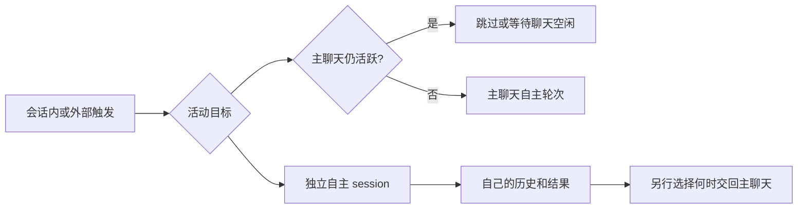

# 心跳的不同跳法

更新：2026-10-05。这里比较伴侣语境中自主轮次的设计空间；具体平台的合同归 [Heartbeat / channels](heartbeat-and-channels.md)，公开实现证据归 [source dossiers](companion-source-dossiers.md)。这些组合不是已经安装的功能，也没有选出统一默认方案。

心跳可以让一段未完的想法继续，也可以给独处留一点时间，或让一件刚发生的事获得注意。醒来时没有外显消息，仍可能经历了一次内部活动。比较时先说明它给谁、在什么情境下提供了什么机会。

## 先分清谁发起、在哪里活动

“在当前 session 跳”和“从外面跳”还可以继续拆开。外部 timer/runner 可能只是给主聊天投递一个 wake，也可能自己拥有独立的自主 session；触发位置不能代替执行位置。历史是否持续又是第三个选择：独立 session 也可以长期保留自己的历史，或每次从明确的 carryover 开始。

| 组合 | 到点后实际发生什么 | 主聊天还在进行时的研究选择 |
| --- | --- | --- |
| 会话内触发 → 主聊天活动 | 当前 session 的 timer/loop/收尾机制引入自主轮次 | 跳过这次机会，或等整段聊天空下来后重新判断 |
| 外部触发 → 主聊天活动 | runner/服务把 wake 投递给主 session | 同样需要聊天占用判断；“外部”本身不会解决打断 |
| 外部触发 → 独立自主 session | 在另一个 session 内活动，可读明确提供的共同前情快照 | 可以继续自己的活动；结果先留独立历史，回主聊天另作交付选择 |

本轮实验采用的研究约束是：**主聊天仍活跃时，不向主线程插入自主 heartbeat。** 这不是“所有上游都已实现”的事实。必须区分模型正在生成/执行工具的 `turn_busy`，与一段聊天仍在进行的 `chat_active`；两次回复之间模型可能 idle，但聊天仍活跃。实验显式给出这两个状态，不假装已解决真实环境中如何判断聊天结束。

2026-10-05 复核的官方例子也要求分开这些维度：CC 的 session-scoped task 在进程运行且 idle 时触发，busy 时错过的触发折叠为之后的一次；这个 idle 合同没有证明它能判断人类意义上的整段聊天已经结束。[Claude Code scheduled tasks](https://code.claude.com/docs/en/scheduled-tasks#limitations)

OpenClaw 则分别定义执行 context 的 `session`/`isolatedSession` 和交付去向的 `target`；heartbeat 即使使用 isolated context，也仍受所列 busy guards 约束。因此“独立 context”“可与主聊天同时活动”“发送到哪个 channel”也不能互相代替。此处只核文档，未运行这些配置。[OpenClaw heartbeat](https://docs.openclaw.ai/gateway/heartbeat)

社区例子也要沿代码核对：Dylan 的外部 runner 依据 timeline 中可解析的最近 user 时间计算间隔；这个 gate 不等于主聊天 busy lock。见 [该实现的活动判断](companion-source-dossiers.md)。

## “怎么跳”有几个可以分别选择的部分

| 维度 | 可比较的选择 | 会改变什么 |
| --- | --- | --- |
| 什么时候获得一次机会 | 固定间隔、带扰动的间隔、事件、自己约定的时间、空闲窗口、混合 | 自主时间来自哪里；没有新消息时是否仍有空间 |
| 谁决定真正开始 | 每次到点就开始；先用简单条件筛一下；已有活动结束后再开始 | tick、候选事件与真正 turn 的数量和延迟 |
| 谁计时、谁活动 | 会话内/外部触发；主聊天/独立自主 session 执行；各自可持续历史或 fresh carryover | 是否占用当前聊天；历史归谁；自主活动怎样回到共同经历里 |
| 醒来带什么 | 最近共同对话、自己的未完想法、fresh ambient、环境快照、自动召回、事件原文 | 想起什么、是否把过去当此刻、是否还有足够的前情 |
| 忙碌与重叠怎么办 | 排队逐项、合并原因、过时取消、稍后再判、跳过纯检查 | 是否积压；事件身份和未处理人类消息是否仍保留 |
| 这一轮怎样结束 | 留下内部结果、联系、安静结束、约下一次、结束计划 | 是否留下可承接的经历；对外发送是否真的完成 |

这些维度可以组合。例如“事件触发”既可在当前窗口继续，也可进入独立自主窗口；“固定时间”既可带来完整自主活动，也可仅做一次轻量检查。固定/随机/事件这几个名字不能单独决定输入和行为。

## 几种具体组合

| 跳法 | 一个合成情境 | 值得观察的代价或缺口 |
| --- | --- | --- |
| 固定节律 | 每隔一段时间获得自主时间，继续读书、构思或想起共同经历 | 没有新外部事件也会获得机会；重复前情如何处理 |
| 有扰动的节律 | 间隔略有变化，自主时间不总落在同一个整点 | 扰动只改变时刻，本身不增加兴趣或自主判断；实验必须可复现 |
| 事件唤醒 | 一段资料处理完毕，或一个订阅的环境事件到达 | 事件怎样成为材料；机器通知不应冒充人刚说的话 |
| 自己约下一次 | 留下“过一会儿想接着写”的计划，到时重新进入 | 计划理由和未完内容是否回来；何时完成、改期或取消 |
| 空闲窗口 | 当前交互停下来一段时间后，获得一个自主轮次 | 使用的是可观测活动时间；不能据此推断人的睡眠、心情或联系需要 |
| 收尾续想 | 一轮结束时发现还有想继续的内容，再承接一段 | 与远期唤醒不同；要看真实 harness 的 Stop/continuation 合同 |
| 先筛后醒 | timer 先检查指定来源有无变化，有材料才起 turn | 节约检查成本，但若作为唯一入口，会减少没有外部事件的自由时间 |
| 持续自主窗口 | 保留一个自己的窗口，按节律或事件继续内部活动 | 历史增长、工作与共同聊天如何互相承接；进程常驻不自动证明连续性 |
| 混合 | 自己约定的时间、外部事件与周期机会并存 | 同一时刻有多个理由时，怎样合并而不抹去理由或重复执行 |

这是设计分类，不代表这些组合都已由某个 repo 完整实现。[公开对照](companion-source-dossiers.md) 已展示 Stop/inbox、独立 API、hook 召回与天气包装等不同位置；其它旧来源仍按各自阅读状态标注。

## 用同一段生活片段比较

[离线输入包实验](../experiments/companion-input/README.md) 使用完全合成的时间线，比较六种触发规则与两种会话历史方式，并对主聊天跳过、等聊天空闲、独立活动做单独对照。规则、间隔、freshness 和结果均显式给定，输出是研究用的假设输入包，不是抓取的 CC request，也不是对官方 scheduler 的模拟验收。

重点读一次 wake 的来龙去脉：**为什么到点 → 实际什么时候开始 → 此刻取得哪一版内容 → 原话与包装怎样分开 → 这一轮留下什么 → 下一次如何承接。** 触发规则固定时，再改变会话方式，才能看出历史继承本身造成的差异。

例如某个 tick 在聊天仍活跃时到点，若选择延后，开始前天气更新、记忆发生纠正：拿到点时打好的旧包与开始时重选内容，会给出不同前情。如果当前块已换新，同 session 历史里仍可能留着旧快照；这里要同时检查“当前提供什么”和“过去注入过什么”。

实验中的内部活动、沉默和待确认发送是事先编写的结果，用来检查记录与承接路径；模型会不会自然作出这些选择尚未验证。唤醒次数不排名，少发消息或少用 tokens 也不能单独判定相处更好。

## 与 CC 版本如何连接

决策机制可以作为另一个维度加入，而不替换 trigger、placement 或 history：在规则允许的机会中，用 Clef / Decisions API 式有限选项判断这一轮适合安静、内部活动、准备联系、稍后再看或补信息。任务合同、置信度边界与可跑的离线 replay 见 [Heartbeat decisions](heartbeat-decisions.md)。它不等于换一个 chat LLM，不自行判断真实聊天是否结束，也不会凭选择生成发送权限。

先选要观察的输入和行为，再映射到目标版本实际支持的入口。timer、Stop continuation、scheduled wake、channel push 与 hook context 有不同的能力和生命周期；平台支持哪些参数、恢复哪些计划，以对应版本的文档、types 与实际运行证据分别判断。

本实验无需 CC binary，也不新增生产 scheduler。后续若比较真实实现，可保持合成时间线与验收问题不变，只把“假设输入包”换成真实入口的可观察结果；不能把本实验的合并规则、时限或会话选择直接说成 CC 的默认行为。
